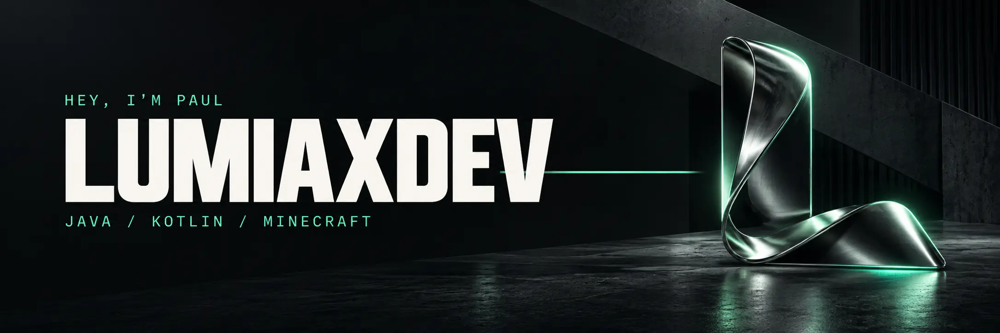
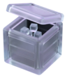

<h3 align="center">Hi, ich bin Paul.</h3>

  Ich entwickle mit Java und Kotlin — und baue mit <a href="https://logsy.de"><b>Logsy Network</b></a> 
  Web-Apps, Gameserver, Discord-Bots und Desktop-Apps, die wir selbst betreiben.

  
  
  

 

## Logsy Network

Ein kleines Studio aus Deutschland. Erst für uns selbst gebaut, jetzt auch für Kunden — und alles läuft auf eigenen Servern.

<table>
  <tr>
    <td width="33%" valign="top">
       
      <a href="https://logsy.de/voice"><b>Logsy Voice</b></a> <code>live</code> 
      Diktieren unter Windows: Taste halten, sprechen, loslassen — läuft auf dem eigenen Rechner.
    </td>
    <td width="33%" valign="top">
       
      <a href="https://iconrp.de"><b>Icon Roleplay</b></a> <code>live</code> 
      GTA-V-Roleplay-Server in Los Santos, eine Stadt von Hand gebaut — mit eigenem Spielerportal.
    </td>
    <td width="33%" valign="top">
       
      <a href="https://musik.logsy.de"><b>Songs erraten</b></a> <code>live</code> 
      Musikquiz für Freunde: Wer kennt den Song zuerst? Auch auf dem Fernseher.
    </td>
  </tr>
  <tr>
    <td valign="top">
       
      <a href="https://wholiked.logsy.de"><b>Who Liked?</b></a> <code>in Arbeit</code> 
      Das Party-Quiz über euch selbst, aus euren eigenen TikTok-Likes.
    </td>
    <td valign="top">
       
      <a href="https://builds.logsy.de"><b>Logsy Builds</b></a> <code>Beta</code> 
      Minecraft-Builds in 3D im Browser ansehen.
    </td>
    <td valign="top">
       
      <a href="https://logsy.de"><b>Projekt anfragen</b></a> 
      Websites, Gameserver, Discord-Bots oder Apps — Erstgespräch kostenlos, danach ein Festpreis.
    </td>
  </tr>
</table>

 

## Womit ich arbeite

 

## Öffentlich hier

- [**cloud**](https://github.com/lumiaxdev/cloud) — Java-/Kotlin-Prototyp mit Konsole und JSON-Konfiguration
- [**swot**](https://github.com/lumiaxdev/swot) — Fork von [JetBrains/swot](https://github.com/JetBrains/swot)
- [**new-swapper**](https://github.com/lumiaxdev/new-swapper) — Fork von [VelocityRL](https://github.com/bitsfdb/VelocityRL)

Der Grossteil meiner Arbeit liegt in privaten Repositories.
