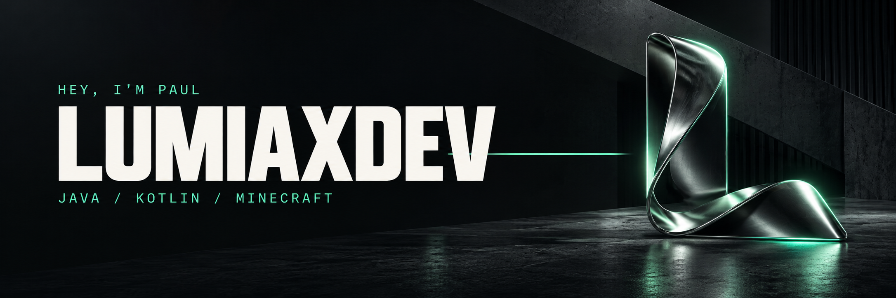
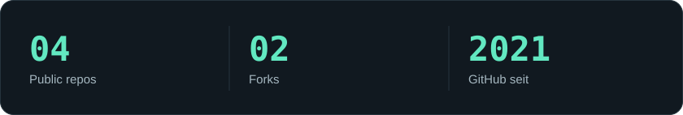
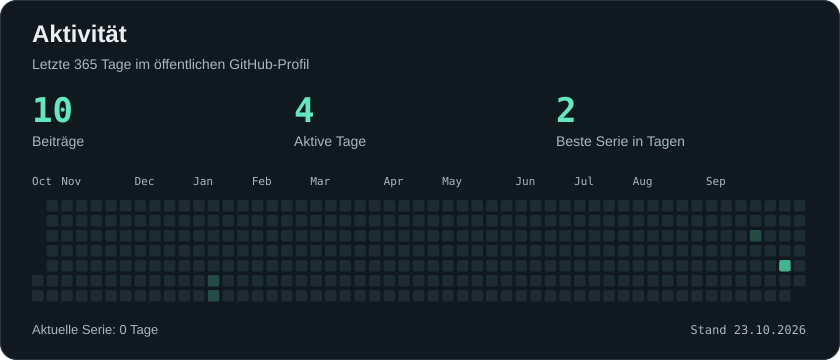
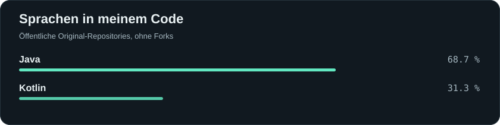

  

<h3 align="center">Hi, ich bin Paul.</h3>

  Ich entwickle mit Java und Kotlin.

  

 

## Technologien

  
  
  
  
  

## GitHub

<picture><source media="(max-width: 600px)" srcset="assets/overview-mobile.svg" /></picture>

  

<picture><source media="(max-width: 600px)" srcset="assets/activity-mobile.svg" /></picture>

  

<picture><source media="(max-width: 600px)" srcset="assets/languages-mobile.svg" /></picture>

Über die Zahlen

Die Zahlen stammen aus öffentlichen GitHub-Daten. Die Sprachanteile zeigen eigenen Code ohne Forks. Den Datenstand findest du in der Aktivitätskarte.

Projekte und Forks

- [cloud](https://github.com/lumiaxdev/cloud): Java-/Kotlin-Prototyp mit Konsole und JSON-Konfiguration.
- [new-swapper](https://github.com/lumiaxdev/new-swapper): Fork von [VelocityRL](https://github.com/bitsfdb/VelocityRL).
- [swot](https://github.com/lumiaxdev/swot): Fork von [JetBrains/swot](https://github.com/JetBrains/swot).

