 

 

  
  
  
  
  
  

 

<b>Öffentlich hier</b>

 

- [**cloud**](https://github.com/lumiaxdev/cloud) — Java-/Kotlin-Prototyp mit Konsole und JSON-Konfiguration
- [**swot**](https://github.com/lumiaxdev/swot) — Fork von [JetBrains/swot](https://github.com/JetBrains/swot)
- [**new-swapper**](https://github.com/lumiaxdev/new-swapper) — Fork von [VelocityRL](https://github.com/bitsfdb/VelocityRL)

Der Grossteil meiner Arbeit liegt in privaten Repositories.

Die Grafiken sind handgebaute, animierte SVGs — kein Dienst, kein Bot.

