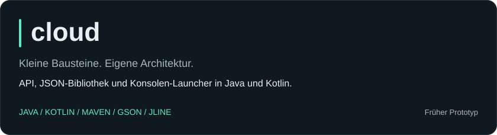

  

<h3 align="center">Java im Editor. Minecraft im Kopf.</h3>

  Ich bin Paul. Ich entwickle mit Java und Kotlin und interessiere mich für Minecraft-Server-Systeme. 
  Hier gibt's meinen Code, Experimente und einen Blick auf meine öffentlichen Projekte.

  
  

 

## Mein Stack

  
  
  
  
  

## Aus meinem Code

<a href="https://github.com/lumiaxdev/cloud"><picture><source media="(max-width: 600px)" srcset="assets/cloud-mobile.svg" /></picture></a>

  <strong>Was drinsteckt:</strong> Command-Verarbeitung, Konsoleneingabe mit Autovervollständigung, Setup-Dialoge und JSON-Konfiguration mit Gson.
  <a href="https://github.com/lumiaxdev/cloud#readme">Zum Code →</a>

## GitHub in Zahlen

<picture><source media="(max-width: 600px)" srcset="assets/overview-mobile.svg" /></picture>

  

<picture><source media="(max-width: 600px)" srcset="assets/activity-mobile.svg" /></picture>

  

<picture><source media="(max-width: 600px)" srcset="assets/languages-mobile.svg" /></picture>

Über die Zahlen

Die Karten verwenden ausschließlich öffentlich abrufbare GitHub-Daten. Die Sprachanteile basieren auf Codebytes eigener öffentlicher Repositories; Forks und dieses Profil-Repository werden ausgeschlossen. Der Aktivitätskalender übernimmt die öffentlich angezeigten GitHub-Beiträge. Beiträge sind nicht mit Commits gleichzusetzen. Der Datenstand steht in der Aktivitätskarte.

## Auch in meinen Repositories

| Fork | Ursprungsprojekt |
| :--- | :--- |
| [new-swapper](https://github.com/lumiaxdev/new-swapper) | [VelocityRL](https://github.com/bitsfdb/VelocityRL): Anpassungen für Rocket League |
| [swot](https://github.com/lumiaxdev/swot) | [JetBrains/swot](https://github.com/JetBrains/swot): Bildungsdomains für akademische Lizenzen |

 

<strong>Code ansehen. Ideen mitnehmen. Weiterbauen.</strong>

